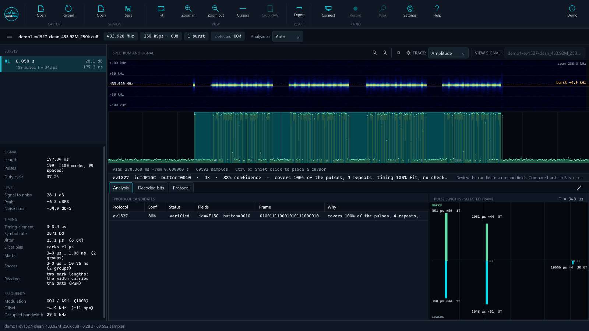

# Signal Visor protocol library

[Signal Visor](https://fotoventus.cz/signalvisor/) is a Windows application for analysing
sub-GHz radio recordings, including 315, 433 and 868 MHz signals. It displays bursts,
pulse timing, decoded symbols and protocol fields from remote controls and wireless sensors.

[](https://fotoventus.cz/signalvisor/)

*Signal Visor analysing a generated EV1527 demo recording. Click the screenshot to visit the application website.*

**This repository contains JSON protocol definitions for Signal Visor.** The application source
code and its capture-based test suite are maintained separately.

Use [Protocol Studio](https://fotoventus.cz/signalvisor/protocol-editor.html) to browse definitions,
load an existing JSON file, create or edit a definition, validate it and download the result.
Browser validation does not verify decoding against a recording.

## Using a definition

Signal Visor loads definitions from two locations:

| Location | Purpose |
|---|---|
| `protocols/` beside `SignalVisor.App.exe` | Definitions bundled with the installed application |
| `Documents/Signal Visor/Protocols/` | User definitions and local overrides |

Download a definition's JSON file and place it in the user folder. Subfolders are supported.
The Documents location is the Windows Documents folder, which may be redirected on your system;
Signal Visor's Settings shows the actual paths and loading errors.

A valid user definition with the same `id` overrides the bundled definition. Use a different ID
for a separate protocol. The application does not automatically download changes from this
repository; the bundled set depends on the installed application version.

## Repository layout

```text
remotes/<id>/<id>.json        remote-control protocol definitions
sensors/<id>/<id>.json        sensor protocol definitions
<group>/<id>/samples/*        optional contributed sample captures
schema/protocol.schema.json  definition format, JSON Schema Draft 2020-12
tools/validate.py            repository validation script
docs/images/                README illustrations
```

Definitions describe how to interpret a protocol. Sample captures contain recorded signals;
they are not required to load a definition. No sample captures are included in the current
repository. References to external capture collections are kept in the application's test suite.

## Definition format

The supported definition format is **schema 1**. The authoritative structure and allowed values
are in [`schema/protocol.schema.json`](schema/protocol.schema.json).

| Property | Contents |
|---|---|
| `schema`, `id`, `name` | Format version, stable identifier and display name |
| `rf` | Modulation (`OOK`, `FSK`, `GFSK`), frequencies in Hz and optional RF parameters |
| `coding` | Coding type, timing element, symbol patterns, synchronization and bit order |
| `frame` | Frame length in symbols, minimum repeats and optional gap |
| `fields` | Named symbol ranges, formats, roles, scaling and units |
| `check` | Optional checksum, CRC or LFSR digest specification |
| `status`, `version`, `description`, `license`, `authors`, `devices`, `classification` | Metadata |
| `exports` | Names or mappings used by supported export targets |
| `tests` | Declared test cases; see verification below |

Only `schema`, `id`, `name`, `rf`, `coding` and `frame` are required at the top level.
Definitions contain data, not executable scripts or expressions. Unsupported transformations
cannot be added as arbitrary JSON properties; they require support in the format and application.

### Symbols, timing and field offsets

- A binary frame uses the alphabet `{0,1}`. PT2262 uses `{0,1,F}`, where `F` is the floating state.
- `frame.length`, field `start` and field `len` count **symbols**. Field offsets start at zero.
  A 12-symbol PT2262 frame contains 12 trits, not 12 bits.
- PWM/PPM patterns are signed multiples of `coding.te_us`, in microseconds. Positive values are
  marks and negative values are spaces. For example, `[1,-3]` at 350 µs represents a 350 µs mark
  followed by a 1050 µs space, before applying `invert`.
- `coding.te_range_us`, when present, specifies a timing-element range. The nominal `te_us`
  must lie within it. These are definition parameters, not measurements of the file being viewed.
- PCM uses `coding.sync.bits` to delimit frames in a bitstream; it does not use pulse patterns.
- Numeric field interpretation depends on the declared format and ordering. Non-binary fields
  use `raw` according to the format contract; checksums require a binary alphabet.
- `check.range` is `[start, end)`: the start is included and the end is excluded. `check.at`
  gives the start of the stored check value.

When comparing test results with another decoder, check its bit-order convention. Test metadata
can describe the relation between `frame_hex` and `rtl433_code` using `rtl433_bit_order`.
Do not assume hexadecimal values from different decoders use the same ordering.

### Compatibility and limits

These JSON files use Signal Visor's format. Export mappings do not make them directly importable
as rtl_433 configurations, Flipper Zero `.sub` files or ESPHome YAML.

Schema 1 describes fixed-length frames and flat field ranges. It has no general payload-transform
pipeline. The Somfy RTS definition therefore exposes the obfuscated frame without named decoded
control, counter or address fields. The KeeLoq definition exposes the encrypted field without
decrypting it. The Bresser 6-in-1 definition does not declare temperature, humidity, wind or rain
fields; its supported fields are listed in the JSON.

## Included definitions

This table summarizes the committed JSON files. Status is the declared verification state;
`draft` is also the default when `status` is omitted. TE is the nominal `coding.te_us` value,
not a measured result. For PCM, TE is documentary rather than a pulse-pattern timing unit.

| ID | Status | Modulation / coding | TE (µs) | Frame | Declared check |
|---|---|---|---:|---|---|
| [`came`](remotes/came/came.json) | draft | OOK / PWM | 320 | 12 bits | Not declared |
| [`came-18`](remotes/came-18/came-18.json) | verified | OOK / PWM | 320 | 18 bits | Not declared |
| [`ev1527`](remotes/ev1527/ev1527.json) | verified | OOK / PWM | 350 | 24 bits | Not declared |
| [`gate-tx`](remotes/gate-tx/gate-tx.json) | verified | OOK / PWM | 350 | 24 bits | Not declared |
| [`holtek-ht12x`](remotes/holtek-ht12x/holtek-ht12x.json) | draft | OOK / PWM | 333 | 12 bits | Not declared |
| [`keeloq`](remotes/keeloq/keeloq.json) | draft | OOK / PWM | 400 | 66 bits | Not declared |
| [`nice-flo`](remotes/nice-flo/nice-flo.json) | draft | OOK / PWM | 700 | 12 bits | Not declared |
| [`pt2262`](remotes/pt2262/pt2262.json) | verified | OOK / PWM | 500 | 12 symbols | Not declared |
| [`somfy-rts`](remotes/somfy-rts/somfy-rts.json) | verified | OOK / MANCHESTER | 604 | 56 bits | Not declared |
| [`acurite-609txc`](sensors/acurite-609txc/acurite-609txc.json) | verified | OOK / PPM | 501 | 40 bits | `sum8` |
| [`bresser-6in1`](sensors/bresser-6in1/bresser-6in1.json) | verified | FSK / PCM | 124 | 144 bits | `lfsr_digest16` |
| [`fineoffset-wh2`](sensors/fineoffset-wh2/fineoffset-wh2.json) | verified | OOK / PWM | 492 | 48 bits | `crc8` |
| [`lacrosse-tx141thb2`](sensors/lacrosse-tx141thb2/lacrosse-tx141thb2.json) | verified | OOK / PWM | 208 | 40 bits | `lfsr_digest8_reflect` |
| [`nexus-th`](sensors/nexus-th/nexus-th.json) | verified | OOK / PPM | 489 | 36 bits | Not declared |

## Verification status and evidence

| Status | Meaning |
|---|---|
| `draft` | The definition has not met the project's capture-based verification requirements. |
| `verified` | The definition is marked as supported by capture-based evidence maintained with the application's tests. |

The schema requires at least one `tests` entry for `verified`. Current verified definitions use
empty objects such as `"tests": [{}, {}]`; these preserve the number and ordering of cases whose
capture references and expected results are maintained separately with the application's tests.
The schema also permits test entries with sample paths and expected values.

**An empty test object is not proof of successful decoding.** This repository's CI does not
retrieve external recordings, run the Signal Visor decoder or establish the correctness of a
`verified` claim. Capture-based verification must be assessed separately. A test that cannot run
because its recording is unavailable does not provide fresh verification.

Changing the timing, framing or field interpretation of a verified definition requires renewed
verification. Keep new or unverified changes marked `draft` and describe available evidence in
the pull request.

## Checking definitions

From this repository's root, with Python installed:

```sh
python -m pip install jsonschema==4.23.0
python tools/validate.py
```

The script checks all JSON files under `remotes/` and `sensors/` for:

- Valid JSON and conformance to the supplied schema.
- A filename and immediate parent directory matching the definition's `id`.
- Unique IDs across both groups.

The [GitHub Actions workflow](.github/workflows/validate.yml) runs the same script on pushes and
pull requests. It does not check sample-file existence or all decoder constraints, such as symbol
sign alternation, field bounds and checksum overlap. Signal Visor performs additional semantic
validation when loading definitions. A successful schema check alone does not establish that a
protocol can be decoded correctly.

## Contributions welcome

New definitions, corrections and sample captures are welcome. Follow
[CONTRIBUTING.md](CONTRIBUTING.md) for the contribution requirements.

1. Copy a suitable existing definition or create one in Protocol Studio.
2. Use `remotes/<id>/<id>.json` or `sensors/<id>/<id>.json` and keep unverified work as `draft`.
3. Describe the protocol in `description`. Put measurement provenance and verification details
   in the pull request.
4. Run `python tools/validate.py` and report the device and evidence used to check the definition.

Contributed samples must follow the repository rules: recordings of your own devices, released
under CC0, without household-identifying information or readings from other people's meters.
Do not submit rolling-code captures from cars, alarms or garage systems. See
[Rules for samples](CONTRIBUTING.md#rules-for-samples) for the full contribution policy.

## Licence

Protocol definitions and contributed sample captures are provided under
[CC0-1.0](LICENSE). Signal Visor itself is a separate application and is not covered by this
repository's definition licence. External recordings are not included or relicensed here.
